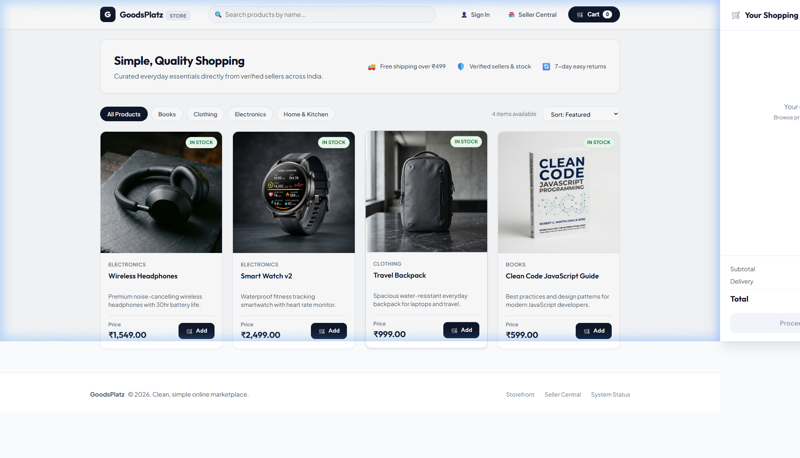
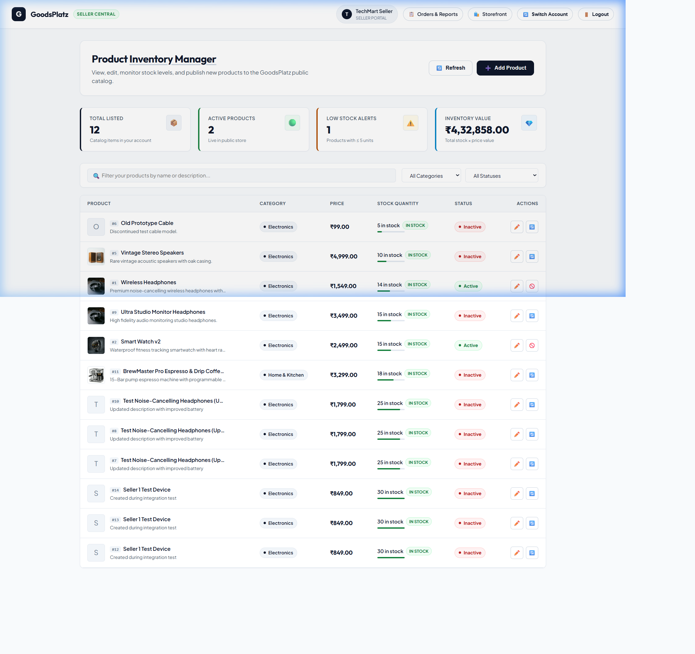
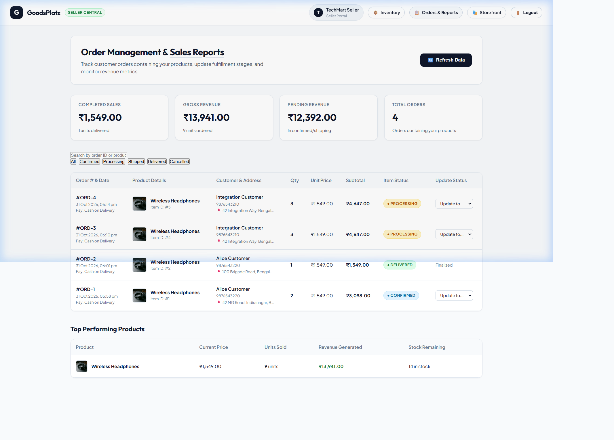

# GoodsPlatz / MarketHub — Online Marketplace Web Application

A full-stack, multi-role online marketplace built with **Node.js**, **Express**, **MySQL**, and **Vanilla JavaScript**.

The marketplace supports four distinct user roles — **Customer**, **Seller**, **Admin**, and **Super Admin** — each with dedicated workflows, strict data isolation, transactional checkout consistency, and audit logging over a shared MySQL database.

---

## Table of Contents

- [Project Overview](#project-overview)
- [Team Members & Responsibilities](#team-members--responsibilities)
- [Features](#features)
- [Technology Stack](#technology-stack)
- [User Roles & Test Credentials](#user-roles--test-credentials)
- [Prerequisites](#prerequisites)
- [Installation](#installation)
- [Environment Configuration](#environment-configuration)
- [Database Setup](#database-setup)
- [Running the Application](#running-the-application)
- [Customer Guide](#customer-guide)
- [API Documentation](#api-documentation)
- [Testing & Quality Assurance](#testing--quality-assurance)
- [Team Contributions](#team-contributions)
- [Screenshots](#screenshots)
- [Project Structure](#project-structure)
- [License](#license)

---

## Project Overview

GoodsPlatz is designed to simulate a realistic online marketplace with multiple autonomous vendors, shoppers, and site administrators. Key architectural tenets include:
- **ACID-compliant transactions**: Orders, cart checkout, and inventory stock updates are processed within MySQL transactions, preventing overselling, negative inventory, or partial order state corruption.
- **Strict Data Isolation**: Sellers have granular access exclusively to their own products and order items; competing sellers cannot inspect or alter each other's data.
- **Administrative Accountability**: High-privilege actions (promotions, seller suspensions, system setting changes) are strictly logged with client IP addresses, actor identities, and timestamps without logging sensitive credentials.

---

## Team Members & Responsibilities

| Team Member | Feature Area & Branch | Core Responsibilities |
|---|---|---|
| **Varshni** | `feature/customer-public-pages` | Customer frontend, authentication, browsing/search, product details, cart, checkout, order history & cancellation, profile management |
| **Kaavyashri** | `feature/backend-seller` | MySQL schema and Database Design, Express server, seller dashboard, inventory stock controls, fulfillment, transactional order backend |
| **Mahalakshmi** | `feature/admin-superadmin` | Admin & Super Admin interfaces, APIs, category management, seller moderation, permissions, reports, and audit logs |

---

## Features

### 🛍️ Customer Experience
- **Customer Registration & Authentication**: Secure account creation with email format and 10-digit mobile validation, bcrypt password hashing (10 salt rounds), and session management via `express-session` (`httpOnly: true`, `sameSite: 'lax'`).
- **Product Catalogue & Search**: Live multi-category browsing, keyword search with debouncing, sorting, and product detail views with responsive layout.
- **Shopping Cart & Checkout**: Slide-out cart drawer and dedicated cart page (`/cart.html`) with real-time subtotal calculation, quantity stepper, stock availability verification, and transactional order checkout with delivery address capture.
- **Order History & Cancellation**: View order status cards, itemized breakdown, and self-service order cancellation for eligible orders (pending/confirmed), returning stock to inventory.
- **Customer Profile**: View profile information, update full name and mobile number, and change password securely.

### 🏪 Seller Portal
- **Inventory Management**: Create, edit, and deactivate products with image URLs, category binding, price formatting, and live stock tracking.
- **Low-Stock Alerting**: Visual low-stock indicators (< 5 units) on the seller inventory dashboard.
- **Order Management & Fulfillment**: Multi-vendor item-level status tracking (`order_items.item_status`). Sellers transition their items through confirmed → processing → shipped → delivered.
- **Sales & Performance Analytics**: Real-time KPI summaries (completed revenue, units sold, pending revenue, total orders) and top-selling product breakdowns.

### 🛡️ Admin & Super Admin Suite
- **Role-Based Access Control (RBAC)**: Fine-grained permissions (`manage_products`, `manage_categories`, `manage_sellers`, `manage_orders`).
- **Super Admin Privileges**: Create and promote administrators, assign and revoke permissions, and modify platform settings.
- **Audit Logging**: Comprehensive, non-blocking activity logger capturing operational events (`ORDER_PLACED`, `SELLER_BLOCKED`, `ADMIN_CREATED`, `SETTING_UPDATED`) with automatic credential sanitization.
- **Admin Management Interfaces**: Dedicated views for managing customers, sellers, products, categories, logs, and settings.

---

## Technology Stack

| Layer | Technologies |
|---|---|
| **Backend Runtime** | Node.js (v18+) & Express 5.x |
| **Database** | MySQL 8.x with `mysql2/promise` connection pooling |
| **Authentication** | `express-session` (cookie-backed session store, `httpOnly: true`, `sameSite: 'lax'`) & `bcryptjs` |
| **Frontend Architecture** | HTML5, Vanilla JavaScript (ES6+), Vanilla CSS with custom properties & responsive media queries |
| **Typography & Assets** | Google Fonts (`Outfit`, `Plus Jakarta Sans`, Arial fallback) |
| **Testing** | Node.js automated HTTP integration test harness (`tests/integration_test.js`, `npm test`) |

---

## User Roles & Test Credentials

The database comes pre-seeded with accounts for all user roles. All test passwords are set to `Marketplace@123`.

| Role | Name | Email | Password | Permissions / Capabilities |
|---|---|---|---|---|
| **Super Admin** | Super Admin | `admin@marketplace.com` | `Marketplace@123` | Full root access, logs, admin permissions, settings |
| **Seller 1** | TechMart Seller | `seller@marketplace.com` | `Marketplace@123` | Electronics catalog, inventory & order items fulfillment |
| **Seller 2** | UrbanTrends Seller | `seller2@marketplace.com` | `Marketplace@123` | Clothing/Books catalog, inventory & sales reports |
| **Customer** | Alice Customer | `customer@marketplace.com` | `Marketplace@123` | Public catalogue browsing, shopping cart, transactional orders |

---

## Prerequisites

Ensure you have the following installed on your machine:
- **Node.js** (v18.0.0 or higher): `node -v`
- **npm** (v9.0.0 or higher): `npm -v`
- **MySQL Server** (v8.0 or higher): `mysql --version`

---

## Installation

1. **Clone the repository**:
   ```bash
   git clone https://github.com/kaavyaMagesh/Online_Marketplace_Web_App.git
   cd Online_Marketplace_Web_App
   ```

2. **Install project dependencies**:
   ```bash
   npm install
   ```

---

## Environment Configuration

1. Copy the example environment template:
   ```bash
   cp .env.example .env
   ```

2. Edit `.env` with your local database credentials:
   ```env
   # Server Configuration
   PORT=5000

   # MySQL Database Configuration
   DB_HOST=localhost
   DB_PORT=3306
   DB_USER=root
   DB_PASSWORD=your_mysql_password
   DB_NAME=online_marketplace

   # Session Configuration
   SESSION_SECRET=online_marketplace_secret_key
   ```
   > **Note**: `.env` is ignored by Git in `.gitignore` to prevent sensitive credentials from ever entering version control.

---

## Database Setup

1. **Create the MySQL Database & Schema**:
   Run the schema script in your MySQL client:
   ```bash
   mysql -u root -p < database/schema.sql
   ```
   Or execute directly in MySQL shell:
   ```sql
   CREATE DATABASE IF NOT EXISTS online_marketplace;
   USE online_marketplace;
   SOURCE database/schema.sql;
   ```

2. **Run Migrations & Seed Default Data**:
   ```bash
   # Run schema column & table migrations
   npm run migrate

   # Seed default categories, test users, system settings, and products
   npm run seed
   ```

---

## Running the Application

1. **Development Mode (with auto-restart)**:
   ```bash
   npm run dev
   ```

2. **Production Mode**:
   ```bash
   npm start
   ```

3. **Access the application in your browser**:
   - **Storefront**: [http://localhost:5000/](http://localhost:5000/)
   - **Explore Products**: [http://localhost:5000/products.html](http://localhost:5000/products.html)
   - **Shopping Cart**: [http://localhost:5000/cart.html](http://localhost:5000/cart.html)
   - **Customer Orders**: [http://localhost:5000/orders.html](http://localhost:5000/orders.html)
   - **Customer Profile**: [http://localhost:5000/profile.html](http://localhost:5000/profile.html)
   - **Seller Inventory Central**: [http://localhost:5000/seller/dashboard.html](http://localhost:5000/seller/dashboard.html)
   - **Seller Orders & Sales Reports**: [http://localhost:5000/seller/orders.html](http://localhost:5000/seller/orders.html)
   - **Admin Panel**: [http://localhost:5000/admin/dashboard.html](http://localhost:5000/admin/dashboard.html)
   - **Super Admin Dashboard**: [http://localhost:5000/admin/super-dashboard.html](http://localhost:5000/admin/super-dashboard.html)
   - **Sign In**: [http://localhost:5000/login.html](http://localhost:5000/login.html)
   - **System Health Status**: [http://localhost:5000/api/health](http://localhost:5000/api/health)

---

## Customer Guide

For a step-by-step customer demonstration script suitable for evaluation, see:
📄 **[docs/customer-demo.md](docs/customer-demo.md)**

### Browsing and Adding to Cart
- Navigate to `/products.html` to filter products by category or perform instant keyword search.
- Click any product to open its detail page (`/product-details.html?id=:id`) with stock indicators and quantity steppers.
- Click **Add to Cart** to update your server-side cart.

### Checking Out
- Go to `/cart.html` or open the cart modal.
- Click **Proceed to Checkout** to open `/checkout.html`.
- Enter delivery recipient details and shipping address.
- Click **Place Order** to execute a transactional checkout.

### Order Management & Cancellation
- Visit `/orders.html` to review all placed orders.
- Expand details to review ordered products and delivery address.
- If the order is still `pending` or `confirmed`, click **Cancel Order** to cancel and automatically restore product stock.

---

## API Documentation

### 1. Authentication & Profile (`/api/auth`)
| Method | Endpoint | Description | Auth Required |
|---|---|---|---|
| `POST` | `/api/auth/register` | Register new customer account | No |
| `POST` | `/api/auth/login` | Authenticate user & create session | No |
| `GET` | `/api/auth/me` | Inspect current session user | No |
| `POST` | `/api/auth/logout` | Terminate session & clear cookies | Yes |
| `GET` | `/api/auth/profile` | Retrieve customer profile and last address | Yes |
| `PUT` | `/api/auth/profile` | Update profile name and phone number | Yes |
| `PUT` | `/api/auth/password` | Update account password with verification | Yes |

### 2. Product Catalogue (`/api/products`)
| Method | Endpoint | Description | Auth Required |
|---|---|---|---|
| `GET` | `/api/products` | Browse active products (filters: `search`, `category`) | No |
| `GET` | `/api/products/:id` | View product details and category info | No |
| `GET` | `/api/categories` | List active product categories | No |

### 3. Shopping Cart (`/api/cart`)
| Method | Endpoint | Description | Auth Required |
|---|---|---|---|
| `GET` | `/api/cart` | View cart items, line calculations, and totals | Yes |
| `POST` | `/api/cart` | Add product to cart with server-side stock checks | Yes |
| `POST` | `/api/cart/items` | Add product / increment quantity (alias) | Yes |
| `PATCH` | `/api/cart/items/:productId` | Update cart item quantity | Yes |
| `DELETE` | `/api/cart/items/:productId` | Remove individual line item from cart | Yes |
| `DELETE` | `/api/cart` | Clear entire shopping cart | Yes |

### 4. Orders & Checkout (`/api/orders`)
| Method | Endpoint | Description | Auth Required |
|---|---|---|---|
| `POST` | `/api/orders` | **Transactional checkout**: validates stock, deducts inventory, records order & line items, clears cart | Yes |
| `GET` | `/api/orders` | List customer order history | Yes |
| `GET` | `/api/orders/:id` | Retrieve specific order details | Yes |
| `PATCH` | `/api/orders/:id/cancel` | Cancel order and restock inventory | Yes |

### 5. Seller Management (`/api/seller`)
| Method | Endpoint | Description | Auth Required |
|---|---|---|---|
| `GET` | `/api/seller/products` | List products owned by authenticated seller | Seller / Admin |
| `POST` | `/api/seller/products` | Create new product in seller inventory | Seller / Admin |
| `PUT` | `/api/seller/products/:id` | Update product details (ownership verified) | Seller / Admin |
| `DELETE` | `/api/seller/products/:id` | Deactivate product (soft delete) | Seller / Admin |
| `GET` | `/api/seller/orders` | List orders containing seller's items | Seller / Admin |
| `PATCH` | `/api/seller/orders/:itemId/status`| Transition order item status (`confirmed` → `processing` → `shipped` → `delivered`) | Seller / Admin |
| `GET` | `/api/seller/reports` | View seller sales metrics, revenue, and top products | Seller / Admin |

### 6. Administration & Super Admin (`/api/admin` & `/api/superadmin`)
| Method | Endpoint | Description | Auth Required |
|---|---|---|---|
| `GET` | `/api/admin/check` | Verify authenticated user is an active Admin | Admin / Super Admin |
| `GET` | `/api/admin/super/check` | Verify authenticated user is a Super Admin | Super Admin |
| `GET` | `/api/admin/sellers` | List registered sellers and status | Admin (`manage_sellers`) |
| `PATCH` | `/api/admin/sellers/:id/status` | Block or unblock seller account | Admin (`manage_sellers`) |
| `POST` | `/api/admin/categories` | Add product category | Admin (`manage_categories`) |
| `PATCH` | `/api/admin/products/:id/status` | Toggle product active status | Admin (`manage_products`) |
| `GET` | `/api/superadmin/logs` | Query system audit logs with actor info | Super Admin |
| `GET` | `/api/superadmin/admins` | List administrators and assigned permissions | Super Admin |
| `POST` | `/api/superadmin/admins` | Create or promote an administrator | Super Admin |
| `GET` | `/api/superadmin/permissions`| View all system permissions | Super Admin |
| `PUT` | `/api/superadmin/permissions/:id`| Assign or revoke admin permissions | Super Admin |
| `GET` | `/api/superadmin/settings` | View global system configuration | Super Admin |
| `PUT` | `/api/superadmin/settings/:key`| Update system configuration setting | Super Admin |

---

## Testing & Quality Assurance

The application features comprehensive automated integration tests covering customer, seller, cart/order transactions, and administration security.

### Running Automated Integration Tests
```bash
npm test
```
To run all test suites across Days 4, 6, 7, 8, and 9:
```bash
npm run test:all
```

### Verified Test Cases
Refer to [tests/api-checklist.md](tests/api-checklist.md) for the complete checklist:
- **Transactional Consistency**: Rollback verification ensures that if stock is insufficient, zero inventory is lost and no partial order records remain.
- **Cross-Seller Security**: Verified that Seller B receives `403 Forbidden` if attempting to modify Seller A's product or change the status of another vendor's order item.
- **Administrative Privileges**: Ordinary admins cannot view Super Admin logs or alter settings without appropriate permissions.
- **Data Sanitization**: Plaintext passwords, tokens, and secrets are strictly redacted from `system_logs`.

---

## Team Contributions

| Day | Module / Milestone | Primary Focus |
|---|---|---|
| **Day 1–3** | Database & Server Foundation | MySQL schema setup, connection pooling, base REST setup |
| **Day 4–5** | Catalog & Seller Products | Product catalog filters, search, seller inventory management UI |
| **Day 6** | Transactional Checkout | `POST /api/orders`, stock deduction, MySQL transaction rollback |
| **Day 7** | Seller Orders & Sales Reports | Item-level fulfillment status tracking, sales reports analytics |
| **Day 8** | Super Admin & Audit Logging | Permissions enforcement, audit trail logging with sensitive redaction |
| **Day 9** | Full System Integration | Multi-role workflow unification, error handling, checklist verification |
| **Day 10** | Final Polish & Documentation | Deployment readiness, user guide, and demo walkthrough |

---

## Screenshots

### 1. GoodsPlatz Storefront & Shopping Cart


### 2. Seller Inventory Management Dashboard


### 3. Seller Order Fulfillment & Sales Reports


---

## Project Structure

```
Online_Marketplace_Web_App/
├── database/
│   ├── schema.sql              # Database and table definitions
│   ├── seed.sql                # Sample category and initial data
│   ├── migrate.js              # Database migrations runner
│   ├── seed_data.js            # Comprehensive multi-role seed script
│   └── README.md               # Database setup instructions
├── docs/
│   └── customer-demo.md        # Customer demonstration script
├── frontend/                   # Admin & Super Admin frontend
│   ├── login.html              # Dedicated admin login page
│   └── admin/
│       ├── css/admin.css       # Admin dashboard styles
│       ├── js/admin.js         # Admin access verification
│       ├── js/roleRedirect.js  # Role redirect logic
│       ├── dashboard.html      # Admin main dashboard
│       ├── customers.html      # Customer management
│       ├── sellers.html        # Seller moderation
│       ├── products.html       # Product moderation
│       ├── categories.html     # Category management
│       └── super-dashboard.html# Super admin controls
├── middleware/
│   └── auth.js                 # Authentication & full RBAC permission middleware
├── public/                     # Static customer & seller frontend
│   ├── index.html              # Homepage & storefront
│   ├── products.html           # Product listing & category filter
│   ├── product-details.html    # Single product view
│   ├── login.html              # Login form
│   ├── register.html           # Registration form
│   ├── cart.html               # Shopping cart page
│   ├── checkout.html           # Checkout and order placement
│   ├── orders.html             # Order history & cancellation
│   ├── profile.html            # Customer profile management
│   ├── seller/
│   │   ├── dashboard.html      # Seller inventory management
│   │   └── orders.html         # Seller order fulfillment & sales reports
│   ├── css/
│   │   ├── style.css           # Customer stylesheet
│   │   ├── auth.css            # Auth page styles
│   │   ├── store.css           # Storefront design styles
│   │   └── seller.css          # Seller dashboard styles
│   └── js/
│       ├── common.js           # Shared nav, footer, auth state
│       ├── auth.js             # Login and registration logic
│       ├── products.js         # Product listing and search
│       ├── product-details.js  # Single product view
│       ├── cart.js             # Cart management
│       ├── checkout.js         # Checkout flow
│       ├── orders.js           # Order history and cancellation
│       ├── profile.js          # Profile management
│       ├── seller-dashboard.js # Seller inventory management logic
│       └── seller-orders.js    # Seller fulfillment & reports logic
├── routes/
│   ├── adminRoutes.js          # Admin role verification endpoints
│   ├── authRoutes.js           # Auth & profile endpoints
│   ├── productRoutes.js        # Product catalogue alias
│   └── sellerRoutes.js         # Seller route delegates
├── server/
│   ├── db.js                   # MySQL connection pool & transactional delegates
│   ├── server.js               # Express app entry point
│   ├── utils/
│   │   └── logger.js           # Sanitized audit trail logger
│   └── routes/
│       ├── admin.js            # Admin moderation endpoints
│       ├── cart.js             # Shopping cart logic
│       ├── cartRoutes.js       # Customer cart alias
│       ├── orderRoutes.js      # Customer order routes
│       ├── orders.js           # Transactional checkout & cancellation
│       ├── products.js         # Product catalogue
│       ├── sellerOrders.js     # Seller fulfillment endpoints
│       ├── sellerProducts.js   # Seller inventory CRUD
│       ├── sellerReports.js    # Seller sales KPI analytics
│       └── superadmin.js       # Super admin permissions & audit logs
├── tests/
│   ├── integration_test.js     # Master automated test suite
│   ├── test_day4.js            # Day 4 catalog tests
│   ├── test_day6.js            # Day 6 checkout transaction tests
│   ├── test_day7.js            # Day 7 seller fulfillment tests
│   ├── test_day8.js            # Day 8 superadmin & audit log tests
│   └── api-checklist.md        # Feature checklist
├── wireframes/                 # Wireframe design assets
├── .env.example                # Environment variable template
├── .gitignore                  # Excludes .env, node_modules
└── package.json                # Dependencies and scripts
```

---

## License

This project is licensed under the ISC License.
